# Nawy Proptech Platform — Data Warehouse Design

> **A Kimball dimensional model optimized for analytical queries across all Nawy business lines**


## 🧩 Dimensional Model

### Complete Star Schema

```mermaid
erDiagram
    DimDate ||--o{ FactDeal : "closed on"
    DimDate ||--o{ FactLead : "created on"
    DimDate ||--o{ FactMortgagePayment : "due on"
    DimDate ||--o{ FactRentPayment : "due on"
    DimDate ||--o{ FactShareInvestment : "invested on"
    DimDate ||--o{ FactRevenue : "recognized on"
    DimDate ||--o{ FactUserActivity : "activity date"

    DimUser ||--o{ FactLead : "buyer"
    DimUser ||--o{ FactDeal : "buyer"
    DimUser ||--o{ FactMortgageApplication : "applicant"
    DimUser ||--o{ FactShareInvestment : "investor"
    DimUser ||--o{ FactManagementContract : "owner"
    DimUser ||--o{ FactRentPayment : "receives"
    DimUser ||--o{ FactUserActivity : "actor"

    DimProperty ||--o{ FactPropertyListing : "listing"
    DimProperty ||--o{ FactLead : "property of interest"
    DimProperty ||--o{ FactDeal : "sold"
    DimProperty ||--o{ FactMortgageApplication : "financed"
    DimProperty ||--o{ FactShareOffering : "underlying"
    DimProperty ||--o{ FactManagementContract : "managed"
    DimProperty ||--o{ FactLease : "leased"
    DimProperty ||--o{ FactRentPayment : "rented"

    DimBroker ||--o{ FactLead : "handles"
    DimBroker ||--o{ FactDeal : "closes"
    DimBroker ||--o{ FactCommission : "earns"

    DimDeveloper ||--o{ FactPropertyListing : "develops"
    DimDeveloper ||--o{ FactShareOffering : "owns"

    DimGeography ||--o{ FactPropertyListing : "located in"
    DimGeography ||--o{ FactLead : "region of interest"

    DimProduct ||--o{ FactRevenue : "revenue source"
    DimProduct ||--o{ FactUserActivity : "activity type"

    FactDeal ||--o| FactCommission : "generates"
    FactMortgageApplication ||--o{ FactMortgagePayment : "has installments"
    FactShareOffering ||--o{ FactShareInvestment : "receives"
    FactShareInvestment ||--o| FactShareExit : "exits"
    FactManagementContract ||--o{ FactLease : "administers"
    FactLease ||--o{ FactRentPayment : "generates"
```



---

## 📊 Fact Tables

Each fact table is documented with its **business process, grain, dimensions, and measures**.

### FACT 1 — `FactPropertyListing`

**Business Process**: A property is listed on the platform.

| Attribute | Value |
|-----------|-------|
| **Grain** | One row per property listing snapshot per day |
| **Type** | Periodic snapshot |
| **Rows (year)** | ~180,000 (520 properties × 365 days) |
| **Update pattern** | Daily refresh |

**Dimensions**: `DimDate`, `DimProperty`, `DimUser (owner)`, `DimBroker`, `DimDeveloper`, `DimGeography`, `DimProduct`

**Measures**:

| Measure | Type | Description |
|---------|------|-------------|
| `price_egp` | Additive (semi) | Listed price |
| `price_per_sqm_egp` | Non-additive | Computed ratio |
| `days_on_market` | Additive | Days since listing |
| `view_count` | Additive | (from activity log) |
| `lead_count` | Additive | Leads generated |
| `is_active_flag` | Additive | 1 if active, 0 if not |
| `is_sold_flag` | Additive | 1 if sold |

**Example query**:
```sql
SELECT
    d.year, d.month,
    g.city,
    AVG(f.price_per_sqm_egp) AS avg_price_per_sqm
FROM nawy_dw.FactPropertyListing f
JOIN nawy_dw.DimDate d ON f.date_key = d.date_key
JOIN nawy_dw.DimGeography g ON f.geography_key = g.geography_key
GROUP BY d.year, d.month, g.city;
```

---

### FACT 2 — `FactLead`

**Business Process**: A prospective buyer expresses interest in a property.

| Attribute | Value |
|-----------|-------|
| **Grain** | One row per lead |
| **Type** | Transaction |
| **Rows (year)** | ~1,400 |
| **Update pattern** | Real-time append |

**Dimensions**: `DimDate (created, last activity)`, `DimUser (buyer)`, `DimProperty`, `DimBroker`, `DimGeography`, `DimProduct (source)`

**Measures**:

| Measure | Type | Description |
|---------|------|-------------|
| `days_in_pipeline` | Additive | Days from creation to last activity |
| `is_won_flag` | Additive | 1 if closed_won |
| `is_lost_flag` | Additive | 1 if closed_lost |
| `is_open_flag` | Additive | 1 if still open |
| `conversion_days` | Additive | Days to close (NULL if open) |

**Bus matrix row**: source-based segmentation, broker attribution, funnel analysis.

---

### FACT 3 — `FactDeal`

**Business Process**: A property transaction is completed.

| Attribute | Value |
|-----------|-------|
| **Grain** | One row per completed deal |
| **Type** | Transaction |
| **Rows (year)** | ~380 |
| **Update pattern** | Real-time append |

**Dimensions**: `DimDate (closed)`, `DimUser (buyer)`, `DimProperty`, `DimBroker`, `DimDeveloper`, `DimGeography`, `DimProduct (payment type)`

**Measures**:

| Measure | Type | Description |
|---------|------|-------------|
| `sale_price_egp` | Additive | Final sale price |
| `list_price_egp` | Additive | Original list price |
| `discount_egp` | Additive | list_price − sale_price |
| `discount_pct` | Non-additive | Discount percentage |
| `days_to_close` | Additive | Days from lead to close |
| `commission_amount_egp` | Additive | Broker commission |
| `gmv_egp` | Additive | Gross merchandise value |

---

### FACT 4 — `FactCommission`

**Business Process**: A broker earns a commission from a completed deal.

| Attribute | Value |
|-----------|-------|
| **Grain** | One row per commission payment |
| **Type** | Transaction |
| **Rows (year)** | ~375 |
| **Update pattern** | Event-driven |

**Dimensions**: `DimDate (paid)`, `DimUser (broker)`, `DimBroker`, `DimProperty`, `DimProduct (commission type)`

**Measures**:

| Measure | Type | Description |
|---------|------|-------------|
| `commission_amount_egp` | Additive | Amount |
| `commission_rate` | Non-additive | Percentage rate |
| `days_to_payment` | Additive | Days from deal to payment |
| `is_paid_flag` | Additive | 1 if paid |

---

### FACT 5 — `FactMortgageApplication`

**Business Process**: A user applies for a Nawy Now mortgage.

| Attribute | Value |
|-----------|-------|
| **Grain** | One row per mortgage application |
| **Type** | Accumulating snapshot |
| **Rows (year)** | ~280 |
| **Update pattern** | Daily update as status changes |

**Dimensions**: `DimDate (submitted, approved)`, `DimUser (applicant)`, `DimProperty`, `DimGeography`, `DimProduct`

**Measures**:

| Measure | Type | Description |
|---------|------|-------------|
| `property_price_egp` | Additive | Property price |
| `down_payment_egp` | Additive | Down payment |
| `loan_amount_egp` | Additive | Loan principal |
| `monthly_payment_egp` | Additive | Fixed monthly installment |
| `installment_months` | Additive | Term in months |
| `interest_rate` | Non-additive | Annual rate |
| `days_to_approval` | Additive | Submission → approval |
| `is_approved_flag` | Additive | 1 if approved |
| `is_disbursed_flag` | Additive | 1 if disbursed |

---

### FACT 6 — `FactMortgagePayment`

**Business Process**: A mortgage installment is due or paid.

| Attribute | Value |
|-----------|-------|
| **Grain** | One row per installment |
| **Type** | Transaction |
| **Rows (year)** | ~4,200 |
| **Update pattern** | Daily |

**Dimensions**: `DimDate (due, paid)`, `DimUser (borrower)`, `DimProperty`

**Measures**:

| Measure | Type | Description |
|---------|------|-------------|
| `amount_due_egp` | Additive | Expected payment |
| `amount_paid_egp` | Additive | Actual payment |
| `amount_outstanding_egp` | Additive | amount_due − amount_paid |
| `days_late` | Additive | Days past due |
| `is_paid_flag` | Additive | 1 if paid |
| `is_overdue_flag` | Additive | 1 if overdue |

---

### FACT 7 — `FactShareOffering`

**Business Process**: A property is offered for fractional investment.

| Attribute | Value |
|-----------|-------|
| **Grain** | One row per offering (daily snapshot) |
| **Type** | Periodic snapshot |
| **Rows (year)** | ~31,000 (85 offerings × 365 days) |
| **Update pattern** | Daily snapshot |

**Dimensions**: `DimDate`, `DimProperty`, `DimDeveloper`, `DimGeography`, `DimProduct`, `DimStatus`

**Measures**:

| Measure | Type | Description |
|---------|------|-------------|
| `total_value_egp` | Additive | Total offering value |
| `share_price_egp` | Additive | Price per share |
| `total_shares` | Additive | Total shares |
| `shares_sold` | Additive | Sold shares |
| `shares_available` | Additive | Remaining shares |
| `subscribed_egp` | Additive | Total funds raised |
| `sold_pct` | Non-additive | % of shares sold |

---

### FACT 8 — `FactShareInvestment`

**Business Process**: A user invests in a fractional offering.

| Attribute | Value |
|-----------|-------|
| **Grain** | One row per investment transaction |
| **Type** | Transaction |
| **Rows (year)** | ~620 |
| **Update pattern** | Real-time append |

**Dimensions**: `DimDate`, `DimUser (investor)`, `DimProperty`, `DimDeveloper`, `DimGeography`, `DimProduct`

**Measures**:

| Measure | Type | Description |
|---------|------|-------------|
| `shares_purchased` | Additive | Number of shares |
| `total_amount_egp` | Additive | Amount invested |
| `price_per_share_egp` | Non-additive | Purchase price |
| `is_active_flag` | Additive | 1 if active |

---

### FACT 9 — `FactShareExit`

**Business Process**: A fractional investor exits their position.

| Attribute | Value |
|-----------|-------|
| **Grain** | One row per exit event |
| **Type** | Transaction |
| **Rows (year)** | ~185 |
| **Update pattern** | Event-driven |

**Dimensions**: `DimDate (exit date)`, `DimUser (investor)`, `DimProperty`, `DimDeveloper`, `DimGeography`

**Measures**:

| Measure | Type | Description |
|---------|------|-------------|
| `exit_price_per_share_egp` | Non-additive | Sale price |
| `total_sale_value_egp` | Additive | Total proceeds |
| `exit_fee_egp` | Additive | Platform fee |
| `profit_loss_egp` | Additive | Net gain/loss |
| `roi_pct` | Non-additive | Return % |
| `holding_days` | Additive | Days held |

---

### FACT 10 — `FactManagementContract`

**Business Process**: A property owner signs a Nawy Unlocked contract.

| Attribute | Value |
|-----------|-------|
| **Grain** | One row per contract (daily snapshot) |
| **Type** | Periodic snapshot |
| **Rows (year)** | ~77,000 (210 contracts × 365 days) |
| **Update pattern** | Daily snapshot |

**Dimensions**: `DimDate`, `DimUser (owner)`, `DimProperty`, `DimGeography`, `DimProduct (service type)`, `DimStatus`

**Measures**:

| Measure | Type | Description |
|---------|------|-------------|
| `management_fee_pct` | Non-additive | Fee percentage |
| `financing_pct` | Non-additive | Financed portion |
| `contract_days` | Additive | Days active |
| `is_active_flag` | Additive | 1 if active |
| `total_contracts` | Additive | Always 1 (count helper) |

---

### FACT 11 — `FactLease`

**Business Process**: A tenant signs a lease for a managed property.

| Attribute | Value |
|-----------|-------|
| **Grain** | One row per lease |
| **Type** | Accumulating snapshot |
| **Rows (year)** | ~340 |
| **Update pattern** | Daily update as status changes |

**Dimensions**: `DimDate (start, end)`, `DimUser (tenant)`, `DimUser (owner)`, `DimProperty`, `DimGeography`

**Measures**:

| Measure | Type | Description |
|---------|------|-------------|
| `monthly_rent_egp` | Additive | Monthly rent |
| `security_deposit_egp` | Additive | Deposit |
| `lease_days` | Additive | Length in days |
| `is_active_flag` | Additive | 1 if active |
| `is_expired_flag` | Additive | 1 if expired |

---

### FACT 12 — `FactRentPayment`

**Business Process**: A rent installment is due or paid.

| Attribute | Value |
|-----------|-------|
| **Grain** | One row per rent installment |
| **Type** | Transaction |
| **Rows (year)** | ~2,800 |
| **Update pattern** | Daily |

**Dimensions**: `DimDate (due, paid)`, `DimUser (tenant)`, `DimUser (owner)`, `DimProperty`, `DimGeography`

**Measures**:

| Measure | Type | Description |
|---------|------|-------------|
| `amount_egp` | Additive | Rent amount |
| `management_fee_egp` | Additive | Nawy's cut |
| `net_to_owner_egp` | Additive | Owner payout |
| `days_late` | Additive | Days past due |
| `is_paid_flag` | Additive | 1 if paid |
| `is_overdue_flag` | Additive | 1 if overdue |

---

### FACT 13 — `FactEscrow`

**Business Process**: Funds are held in escrow for a transaction.

| Attribute | Value |
|-----------|-------|
| **Grain** | One row per escrow account (daily snapshot) |
| **Type** | Periodic snapshot |
| **Rows (year)** | ~57,000 (155 escrows × 365 days) |
| **Update pattern** | Daily snapshot |

**Dimensions**: `DimDate`, `DimUser`, `DimProperty`, `DimProduct`, `DimStatus`

**Measures**:

| Measure | Type | Description |
|---------|------|-------------|
| `deposit_amount_egp` | Additive | Funds held |
| `holding_days` | Additive | Days in escrow |
| `is_released_flag` | Additive | 1 if released |
| `is_disputed_flag` | Additive | 1 if disputed |
| `is_active_flag` | Additive | 1 if active |

---

### FACT 14 — `FactUserActivity`

**Business Process**: A user performs an action on the platform.

| Attribute | Value |
|-----------|-------|
| **Grain** | One row per activity event |
| **Type** | Transaction |
| **Rows (year)** | ~500,000 (estimated) |
| **Update pattern** | Real-time stream |

**Dimensions**: `DimDate`, `DimUser`, `DimProduct (activity type)`

**Measures**:

| Measure | Type | Description |
|---------|------|-------------|
| `event_count` | Additive | Always 1 |
| `session_duration_sec` | Additive | Time spent |
| `is_conversion_flag` | Additive | 1 if resulted in purchase |

**Activity types**:
- `search`, `view_property`, `save_favorite`, `contact_broker`, `submit_lead`, `view_mortgage`, `invest_shares`, `sign_lease`

---

### FACT 15 — `FactRevenue`

**Business Process**: Revenue is recognized from any business line.

| Attribute | Value |
|-----------|-------|
| **Grain** | One row per revenue recognition event |
| **Type** | Transaction |
| **Rows (year)** | ~2,500 |
| **Update pattern** | Daily |

**Dimensions**: `DimDate`, `DimUser`, `DimProperty`, `DimBroker`, `DimDeveloper`, `DimGeography`, `DimProduct (revenue source)`

**Measures**:

| Measure | Type | Description |
|---------|------|-------------|
| `revenue_amount_egp` | Additive | Revenue amount |
| `cost_amount_egp` | Additive | Cost of service |
| `margin_egp` | Additive | Revenue − Cost |
| `is_recurring_flag` | Additive | 1 if recurring |

**Revenue sources** (product dimension members):
- `broker_commission`, `mortgage_interest`, `shares_exit_fee`, `management_fee`, `finishing_fee`

---

## 📐 Dimension Tables

### DIM 1 — `DimDate` (Conformed, Static)

**Purpose**: Standard date dimension for all time-based analysis.

**Grain**: One row per calendar day.

**Range**: 2020-01-01 to 2030-12-31 (11 years).

| Column | Type | Description |
|--------|------|-------------|
| `date_key` | INT (PK) | YYYYMMDD format (e.g., 20260930) |
| `date` | DATE | Full date |
| `day_of_week` | INT | 1=Sunday, 7=Saturday |
| `day_name` | NVARCHAR | Sunday, Monday, ... |
| `day_of_month` | INT | 1–31 |
| `day_of_year` | INT | 1–366 |
| `week_of_year` | INT | 1–53 |
| `month` | INT | 1–12 |
| `month_name` | NVARCHAR | January, February, ... |
| `quarter` | INT | 1–4 |
| `year` | INT | 2020–2030 |
| `year_month` | NVARCHAR | "2026-09" |
| `year_quarter` | NVARCHAR | "2026-Q3" |
| `is_weekend` | BIT | 1 if Friday/Saturday |
| `is_holiday` | BIT | Egyptian holidays |
| `is_ramadan` | BIT | Islamic calendar flag |
| `is_business_day` | BIT | Working day flag |
| `fiscal_year` | INT | Aligned to fiscal calendar |
| `fiscal_quarter` | INT | |

---

### DIM 2 — `DimUser` (SCD Type 2)

**Purpose**: User dimension with historical tracking.

**Grain**: One row per user per version (SCD Type 2).

| Column | Type | Description |
|--------|------|-------------|
| `user_key` | BIGINT (PK) | Surrogate key (auto-increment) |
| `user_id` | BIGINT | Natural key from OLTP |
| `email` | NVARCHAR | Current email |
| `full_name` | NVARCHAR | Current name |
| `phone` | NVARCHAR | Current phone |
| `user_type` | NVARCHAR | Current primary type |
| `national_id` | NVARCHAR | (masked) |
| `is_verified` | BIT | |
| `registration_date` | DATE | |
| `country` | NVARCHAR | Egypt |
| `city` | NVARCHAR | |
| `acquisition_channel` | NVARCHAR | website, app, referral |
| `lifetime_days` | INT | Days since registration |
| `business_lines_engaged` | INT | Count of business lines |
| `is_vip` | BIT | Derived from CLV |
| `valid_from` | DATETIMEOFFSET | SCD Type 2 |
| `valid_to` | DATETIMEOFFSET | SCD Type 2 |
| `is_current` | BIT | SCD Type 2 flag |

**SCD Type 2 tracking**: Changes to `email`, `phone`, `user_type`, `city` create new versions.

---

### DIM 3 — `DimProperty` (SCD Type 2)

**Purpose**: Property dimension with historical tracking.

**Grain**: One row per property per version.

| Column | Type | Description |
|--------|------|-------------|
| `property_key` | BIGINT (PK) | Surrogate key |
| `property_id` | BIGINT | Natural key |
| `title` | NVARCHAR | |
| `property_type` | NVARCHAR | apartment, villa, chalet, etc. |
| `listing_type` | NVARCHAR | primary, resale, rental |
| `bedrooms` | INT | |
| `bathrooms` | INT | |
| `area_sqm` | DECIMAL | |
| `finishing_status` | NVARCHAR | |
| `furnished_status` | NVARCHAR | |
| `current_price_egp` | DECIMAL | |
| `current_status` | NVARCHAR | active, sold, rented |
| `latitude` | DECIMAL | |
| `longitude` | DECIMAL | |
| `developer_id` | BIGINT | FK |
| `compound_name` | NVARCHAR | |
| `city` | NVARCHAR | |
| `district` | NVARCHAR | |
| `geography_key` | BIGINT | FK to DimGeography |
| `listing_date` | DATE | |
| `days_on_market` | INT | |
| `valid_from` | DATETIMEOFFSET | SCD Type 2 |
| `valid_to` | DATETIMEOFFSET | |
| `is_current` | BIT | |

---

### DIM 4 — `DimBroker` (SCD Type 2)

**Purpose**: Broker dimension.

**Grain**: One row per broker per version.

| Column | Type | Description |
|--------|------|-------------|
| `broker_key` | BIGINT (PK) | |
| `broker_id` | BIGINT | Natural key |
| `broker_name` | NVARCHAR | |
| `email` | NVARCHAR | |
| `broker_type` | NVARCHAR | freelancer, agency |
| `agency_name` | NVARCHAR | |
| `license_number` | NVARCHAR | |
| `commission_rate` | DECIMAL | |
| `team_size` | INT | |
| `status` | NVARCHAR | |
| `joined_date` | DATE | |
| `tenure_days` | INT | |
| `performance_tier` | NVARCHAR | Platinum, Gold, Silver, Bronze |
| `valid_from` | DATETIMEOFFSET | |
| `valid_to` | DATETIMEOFFSET | |
| `is_current` | BIT | |

---

### DIM 5 — `DimDeveloper`

**Purpose**: Real estate developer dimension.

**Grain**: One row per developer.

| Column | Type | Description |
|--------|------|-------------|
| `developer_key` | BIGINT (PK) | |
| `developer_id` | BIGINT | Natural key |
| `name` | NVARCHAR | |
| `partnership_tier` | NVARCHAR | standard, premium, exclusive |
| `contact_email` | NVARCHAR | |
| `contact_phone` | NVARCHAR | |
| `total_projects` | INT | |
| `joined_date` | DATE | |
| `is_active` | BIT | |

---

### DIM 6 — `DimGeography`

**Purpose**: Geographic hierarchy for location analysis.

**Grain**: One row per unique location (city/district/compound combination).

| Column | Type | Description |
|--------|------|-------------|
| `geography_key` | BIGINT (PK) | |
| `city` | NVARCHAR | Cairo, Giza, Alexandria, etc. |
| `district` | NVARCHAR | New Cairo, Sheikh Zayed, etc. |
| `compound` | NVARCHAR | Villette, Marassi, Badya |
| `region` | NVARCHAR | Greater Cairo, North Coast, etc. |
| `latitude` | DECIMAL | |
| `longitude` | DECIMAL | |
| `is_coastal` | BIT | |
| `is_new_development` | BIT | |
| `avg_price_per_sqm` | DECIMAL | Static cache |

---

### DIM 7 — `DimProduct`

**Purpose**: Product and service dimension.

**Grain**: One row per product/service.

| Column | Type | Description |
|--------|------|-------------|
| `product_key` | BIGINT (PK) | |
| `product_code` | NVARCHAR | |
| `product_name` | NVARCHAR | |
| `business_line` | NVARCHAR | Properties, Partners, Now, Shares, Unlocked |
| `service_type` | NVARCHAR | |
| `revenue_model` | NVARCHAR | commission, interest, fee, subscription |
| `is_recurring` | BIT | |

**Product members**:

| Code | Name | Business Line |
|------|------|---------------|
| `PROP_LIST` | Property Listing | Properties |
| `LEAD_CAPTURE` | Lead Capture | Properties |
| `BROKER_COMMISSION` | Broker Commission | Partners |
| `MORTGAGE` | Mortgage Loan | Now |
| `SHARE_OFFERING` | Fractional Offering | Shares |
| `SHARE_INVESTMENT` | Fractional Investment | Shares |
| `MGMT_FULL` | Full Management | Unlocked |
| `MGMT_RENTAL` | Rental Only | Unlocked |
| `FINISHING` | Finishing Service | Unlocked |

---

### DIM 8 — `DimStatus`

**Purpose**: Status dimension for all workflow states.

**Grain**: One row per (entity_type, status_code).

| Column | Type | Description |
|--------|------|-------------|
| `status_key` | BIGINT (PK) | |
| `entity_type` | NVARCHAR | lead, deal, mortgage, lease, etc. |
| `status_code` | NVARCHAR | |
| `status_name` | NVARCHAR | |
| `is_terminal` | BIT | Is it a final state? |
| `is_won` | BIT | Positive outcome? |
| `is_lost` | BIT | Negative outcome? |
| `sort_order` | INT | For funnel ordering |

---


## 🔍 Query Patterns

### Pattern 1 — Time Series Analysis

```sql
SELECT
    d.year_month,
    SUM(f.gmv_egp) AS total_gmv,
    COUNT(f.deal_key) AS deal_count
FROM nawy_dw.FactDeal f
JOIN nawy_dw.DimDate d ON f.closed_date_key = d.date_key
WHERE d.year = 2026
GROUP BY d.year_month
ORDER BY d.year_month;
```

### Pattern 2 — Dimensional Drill-Down

```sql
SELECT
    g.city,
    g.district,
    p.property_type,
    COUNT(f.deal_key) AS deal_count,
    SUM(f.gmv_egp) AS total_gmv
FROM nawy_dw.FactDeal f
JOIN nawy_dw.DimProperty p ON f.property_key = p.property_key
JOIN nawy_dw.DimGeography g ON p.geography_key = g.geography_key
WHERE p.is_current = 1
GROUP BY ROLLUP(g.city, g.district, p.property_type);
```

### Pattern 3 — SCD Type 2 Historical

```sql
-- Property value at specific point in time
SELECT
    p.title,
    p.current_price_egp,
    p.valid_from,
    p.valid_to
FROM nawy_dw.DimProperty p
WHERE p.property_id = 42
ORDER BY p.valid_from;
```

### Pattern 4 — Cross-Business CLV

```sql
SELECT
    u.user_key,
    u.full_name,
    u.business_lines_engaged,
    SUM(r.revenue_amount_egp) AS total_clv
FROM nawy_dw.DimUser u
JOIN nawy_dw.FactRevenue r ON u.user_key = r.user_key
WHERE u.is_current = 1
GROUP BY u.user_key, u.full_name, u.business_lines_engaged
ORDER BY total_clv DESC;
```

### Pattern 5 — Aggregate Table

```sql
-- Fast daily sales from pre-aggregated table
SELECT
    date,
    city,
    total_gmv,
    deal_count,
    avg_deal_size
FROM nawy_dw.AggDailySales
WHERE date >= '2026-01-01';
```

---

## ⚡ Performance Strategy

### Optimization Techniques

| Technique | Applied To | Benefit |
|-----------|-----------|---------|
| **Clustered Columnstore** | Large facts | 10× compression, 5× speed |
| **Partitioning** | Facts by year | Partition elimination |
| **Materialized Aggregates** | Common queries | 100× speedup |
| **Covering Indexes** | Dimension lookups | Index-only scans |
| **Compression** | All tables | 50–70% storage savings |
| **Statistics** | All tables | Better query plans |
| **Resource Governor** | BI workloads | Workload isolation |

### Query Performance Targets

| Query Type | Target | Rationale |
|-----------|--------|-----------|
| Simple aggregation | < 1 sec | Common dashboards |
| Multi-dim join | < 3 sec | Analytical queries |
| YTD totals | < 2 sec | Executive dashboards |
| Full-year trend | < 5 sec | Historical analysis |
| CLV computation | < 10 sec | Complex user analytics |

### Capacity Planning

| Metric | Year 1 | Year 3 | Year 5 |
|--------|--------|--------|--------|
| Fact rows (total) | 500K | 2M | 5M |
| DW size | 5 GB | 25 GB | 60 GB |
| Storage cost | $25/mo | $125/mo | $300/mo |
| Query load (daily) | 10K | 50K | 150K |
